# Sistem Operasi

**Nama :** M.Rizky Putra Wijaya  
**Kelas :** SKU3A  
**NIM :** 09011382530139

## Daftar Perintah Linux dan Dokumentasi

1. uname -a : Menampilkan semua informasi dasar mengenai sistem operasi (kernel name, hostname, release kernel, versi, dan arsitektur mesin hardware).

2. lscpu : Menampilkan informasi detail dan terstruktur tentang arsitektur CPU sistem.

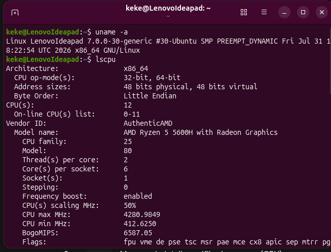

---

3. Lanjutan lscpu : Menampilkan informasi Flags (fitur CPU) dan kapabilitas lainnya.

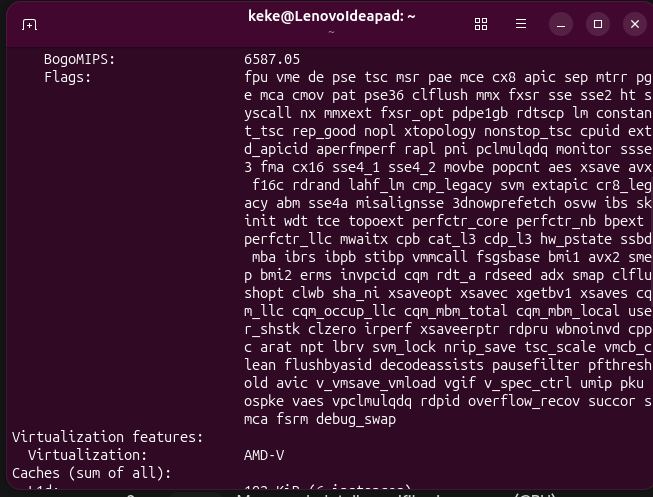

---

4. Lanjutan lscpu : Menampilkan informasi Cache (L1, L2, L3) dan Vulnerabilities mitigasi CPU.

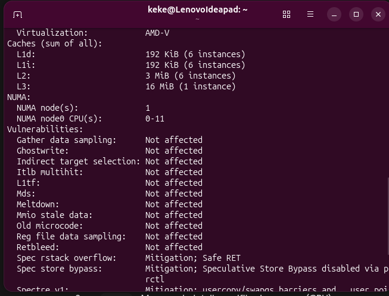

---

5. Lanjutan lscpu : Akhir dari baris output lscpu.

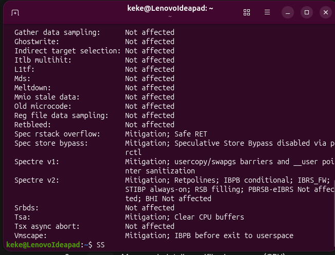

---

6. lsmem (ditulis 'lsmen') : Perintah lsmem digunakan untuk menampilkan rentang memori. Di gambar ini terjadi error karena salah ketik 'lsmen'.

7. lsusb : Menampilkan daftar seluruh perangkat bus USB beserta device yang saat ini sedang terhubung.

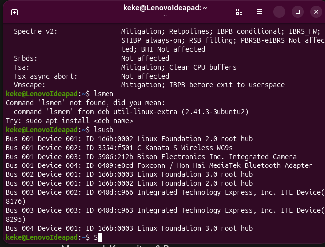

---

8. lspci (ditulis 'Slspci') : Menampilkan informasi tentang semua bus PCI dan perangkat yang terhubung dengannya. (Di gambar typo menjadi 'Slspci').

9. lsblk : Menampilkan informasi mengenai semua perangkat penyimpanan blok (block devices) yang terdeteksi sistem (seperti hardisk, partisi NVMe, loop devices) beserta mountpoint-nya.

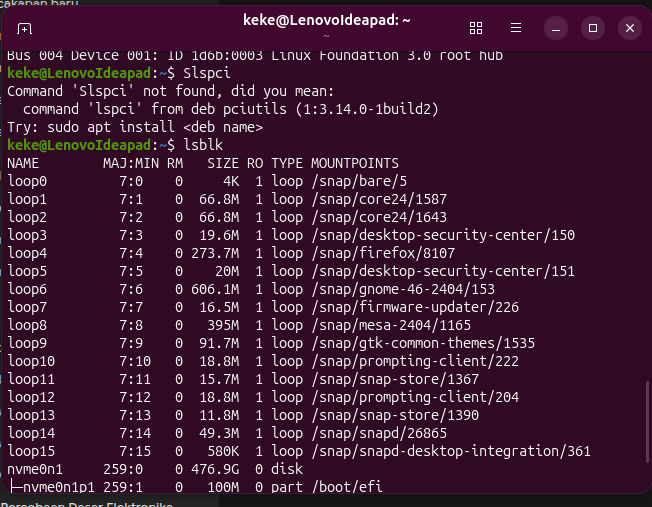

---

10. uptime : Menampilkan seberapa lama sistem komputer telah menyala (berjalan) sejak terakhir dihidupkan, beserta load average.

11. hostname : Menampilkan nama jaringan dari mesin atau komputer yang sedang digunakan.

12. dmesg : Menampilkan pesan dari kernel ring buffer. Terjadi error 'Operation not permitted' karena butuh akses root (sudo).

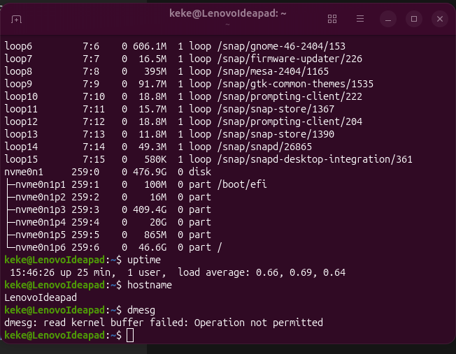

---

13. df -h : Menampilkan statistik ketersediaan dan penggunaan ruang penyimpanan pada disk/partisi dalam format yang mudah dibaca (MB/GB).

14. du -sh . : Menampilkan perkiraan total ukuran ruang disk yang dipakai oleh direktori saat ini (.).

15. free -m : Menampilkan jumlah memori (RAM) fisik dan swap yang digunakan/kosong dalam format Megabytes.

16. vmstat : Menampilkan laporan singkat dan statistik dari memori virtual, proses, disk IO, dan aktivitas sistem.

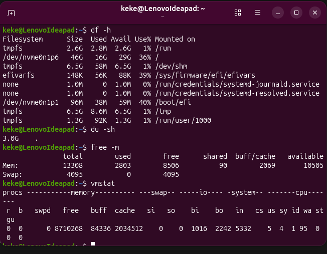

---

17. pwd : Menampilkan jalur absolut direktori tempat Anda berada saat ini (/home/keke).

18. ls -l : Menampilkan daftar isi direktori dengan format panjang (hak akses, pemilik, ukuran, waktu). (Command history #45)

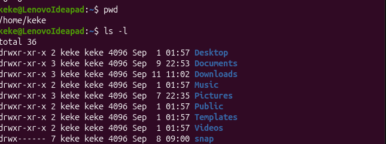

---

19. less : Melihat isi file teks interaktif. Error 'Missing filename' karena file tidak disebutkan. (Command #47)

20. file : Mengecek jenis tipe data file. Menampilkan panduan (usage) jika diketik tanpa argumen. (Command #50)

21. stat : Menampilkan status detail file. Error 'missing operand' karena tidak ada file tujuan. (Command #51)

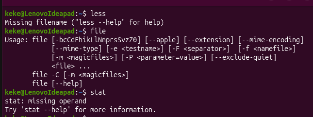

---

22. diff : Membandingkan isi dua file. Error karena tidak ada file yang di-input (missing operand). (Command #53 & #55)

23. ps aux : Menampilkan informasi detail mengenai semua proses yang sedang berjalan di sistem (PID, CPU, memori). (Command #56)

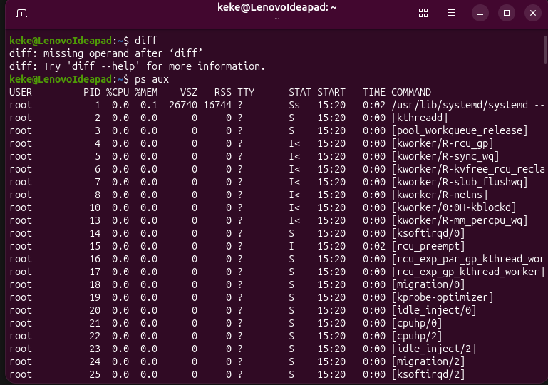

---

24. Lanjutan ps aux : Menampilkan proses kernel dan kworker (lanjutan output).

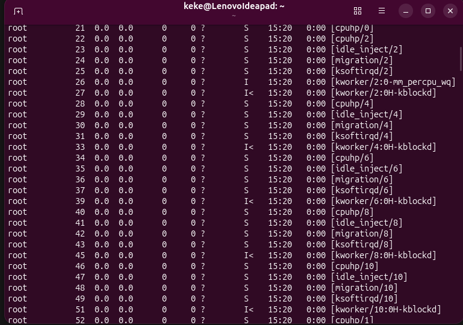

---

25. Lanjutan ps aux : Menampilkan proses idle_inject, ksoftirqd, dan migration (lanjutan output).

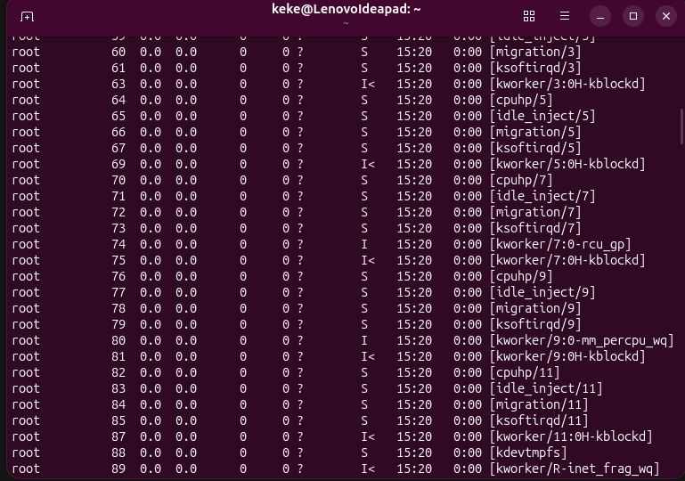

---

26. Lanjutan ps aux : Menampilkan proses oom_reaper, kcompactd, kswapd, dan watchdog (lanjutan output).

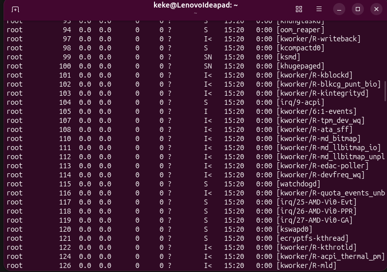

---

27. ping : Menguji konektivitas jaringan. Error 'Destination address required' karena IP tujuan tidak ditulis. (Command #59)

28. ip a : Menampilkan informasi antarmuka jaringan (network interfaces) beserta alamat IP-nya. (Command #60)

29. ss -tuln : Menampilkan statistik socket jaringan (port TCP dan UDP yang sedang listening). (Command #61)

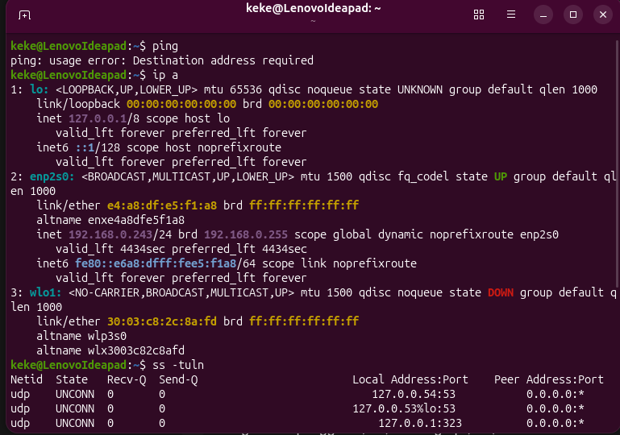

---

30. Lanjutan ss -tuln : Menampilkan output port TCP dan UDP IPv6/IPv4 yang sedang aktif/listening.

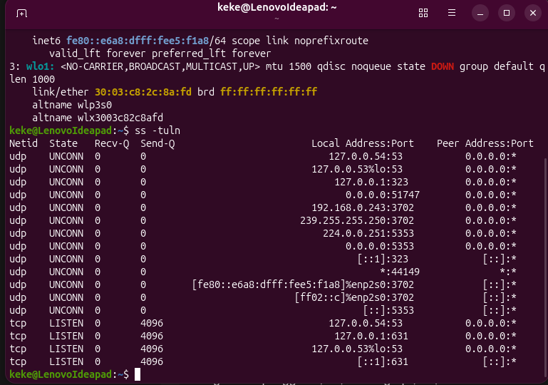

---

31. traceroute : Melacak jalur paket jaringan. (Aplikasi belum terinstall, sistem meminta install inetutils-traceroute). (Command #62)

32. dig : Melakukan query DNS. Terjadi error 'timed out' karena tidak bisa mencapai server DNS lokal (127.0.0.53). (Command #63)

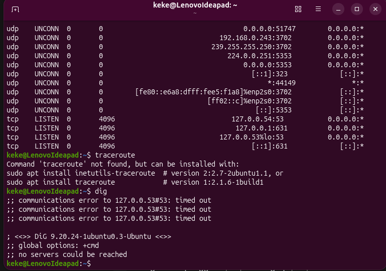

---

33. nslookup : Masuk ke prompt nslookup interaktif untuk query DNS. Server lokal menolak/REFUSED. (Command #64)

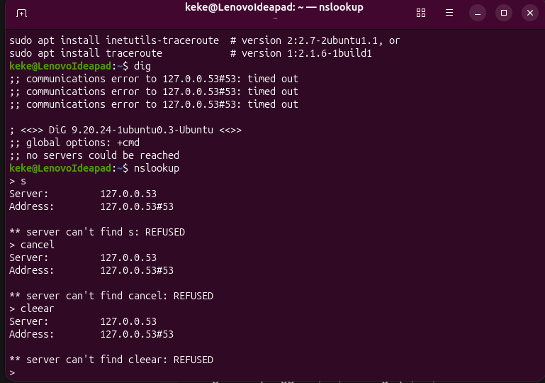

---

34. curl -I : Mengambil informasi header HTTP. (Aplikasi curl belum terinstall). (Command #65)

35. whoami : Menampilkan nama pengguna yang saat ini efektif di terminal (keke). (Command #66)

36. id : Menampilkan informasi User ID (UID), Group ID (GID), dan keanggotaan grup. (Command #67)

37. w : Menampilkan daftar pengguna yang sedang login beserta aktivitasnya. (Command #68)

38. groups : Menampilkan grup tempat user bernaung. (Command #69)

39. history : Menampilkan riwayat perintah yang sebelumnya diketik (menampilkan eksekusi awal seperti: finger, chfn, who). (Command #70)

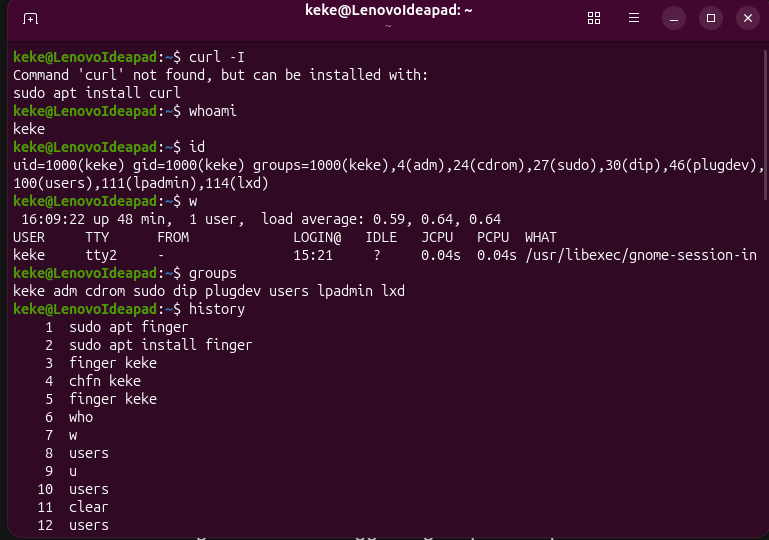

---

40. Lanjutan history : Menampilkan riwayat perintah (command number 45 sampai 70) yang menjadi dasar eksekusi pengetikan di terminal.

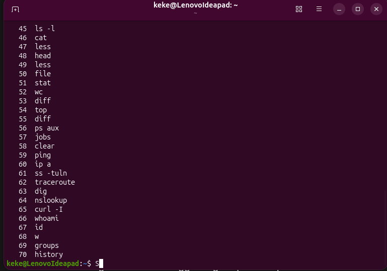

---

41. date: Menampilkan informasi tanggal dan waktu sistem saat ini. (Contoh: ketik date lalu tekan enter).

42. cal: Menampilkan kalender bulan ini langsung di dalam layar terminal.

43. cd: (Change Directory) Berpindah atau masuk dari satu folder ke folder lainnya.

44. mkdir: (Make Directory) Membuat folder atau direktori baru.

45. touch: Membuat sebuah file teks baru yang ukurannya masih kosong.

46. cp: (Copy) Menyalin file dari satu tempat ke tempat lain.

47. mv: (Move) Memindahkan file ke folder lain, atau bisa juga digunakan untuk mengubah nama (rename) sebuah file.

48. echo: Mencetak atau menampilkan kembali teks yang Anda tulis ke layar terminal.

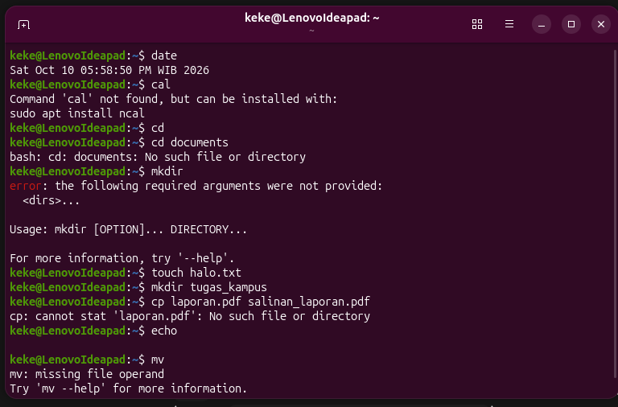

---

49. rm: (Remove) Berfungsi untuk menghapus sebuah file atau dokumen.

50. man: (Manual) Berfungsi untuk menampilkan buku panduan atau instruksi lengkap tentang cara menggunakan sebuah command.

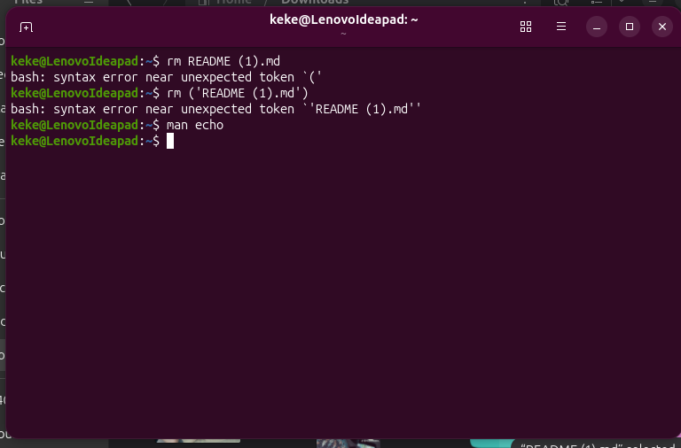

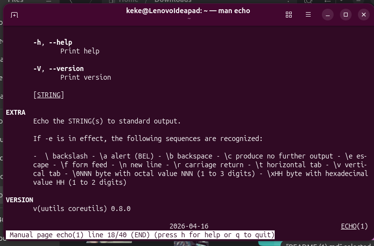

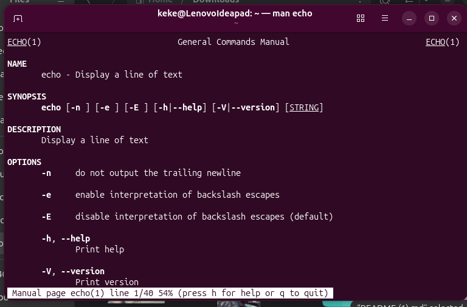

---
